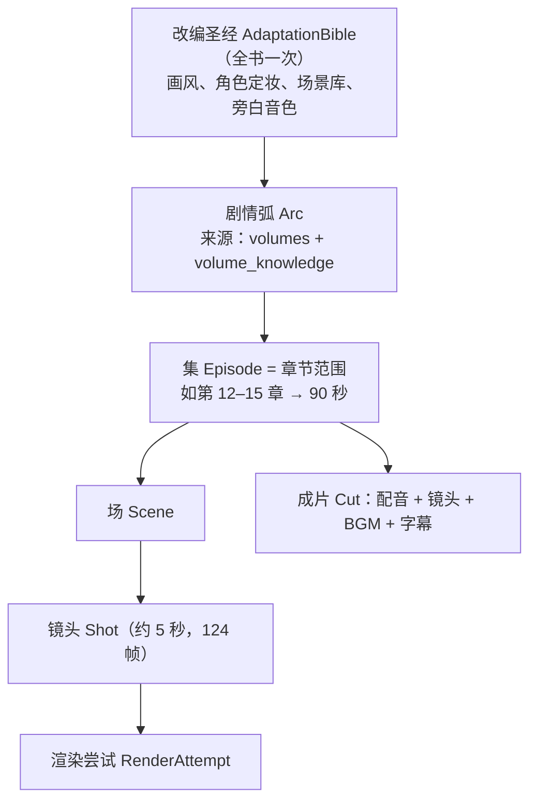

# 长篇小说 → 短剧连载 / 卷预告 视频改编设计

日期：2026-11-18　状态：方向已确认（桌面客户端集成）

## 1. 目标与非目标

**目标**
- 把长篇小说按剧情弧改编为 1–3 分钟/集的**短剧连载**，同一管线产出 30–60 秒的**卷预告**。
- 全书人物、场景、画风在几百集内保持一致。
- 每个镜头可追溯到原文章节与版本；原文修改后提示受影响的集。
- 镜头级的用户反馈（重做、改提示词、弃用）作为分身学习信号，不覆盖原文。

**非目标（第一阶段不做）**
- 逐章 1:1 改编。
- 自动发布到抖音/快手（发布保持显式手动操作）。
- 云端 GPU 渲染（渲染只在用户本机进行）。

## 2. 改编层级



| 层级 | 生成方式 | 输入（复用现有数据） | 用户确认点 |
|---|---|---|---|
| 改编圣经 | AI 初稿 + 用户上传/生成定妆图 | `characters.description`、`canonical_state(character_runtime, world)`、`projects.world_setting/styles` | 定妆图、画风 |
| 剧情弧 → 集 | AI 按节拍切分 | `volumes.summary/key_events`、`volume_knowledge.narrative_summary`、`chapter_knowledge.summary`、`chapter_rhythm`（爽点/高潮/钩子）、`payoff_ledger` | 章节范围、每集看点 |
| 集 → 场 → 镜头 | AI 分镜 | 章节原文 `chapter_contents`（固定 version）+ 改编圣经 | 分镜表 |
| 镜头 → 渲染 | 本机 worker | 关键帧 + 提示词 + 种子 | 逐镜预览/重做 |
| 成片 | 本机合成 | 镜头视频、旁白音频、BGM | 预览、导出 |

**卷预告**：一个 `kind = 'trailer'` 的 Episode，章节范围是整卷，镜头数量限制在 6–12 个，只挑高潮和钩子节拍。

## 3. 实测约束（RTX 3060 12GB，MiniMax H3 i2v + turbo 4 步）

| 项目 | 数值 |
|---|---|
| 5 秒镜头（480×608，124 帧） | 约 100 秒渲染，峰值显存 11.6GB |
| 1 分钟成片（12 镜） | 约 20 分钟渲染 |
| 并发 | 1（显存已满）；配音与渲染串行使用 GPU |
| 内存 | 32GB RAM 时需 `--disable-pinned-memory`，否则连续渲染出现 MemoryError |
| 模型训练时长 | 约 124–362 帧（5–15 秒）；单镜头不应低于 5 秒 |

## 4. 关键设计决策（待确认）

### 4.1 改编功能放在哪里（已定，2026-11-18）

**全部集成在 StoryAlter 2.0 桌面客户端（novel-studio）中**，storyalter 仓库不参与。

- 书稿、角色和事实库都在本机，GPU 也在本机；客户端直接调用本机 ComfyUI（复用 `src/imagelocal.mjs` 的客户端）和 IndexTTS。
- 不做云端任务队列和 worker 鉴权，素材不上传。
- 分集与分镜规划沿用客户端现有的模型调用方式。
- 引擎安装、预检和验收脚本位于 `tools/video/`。
- 两个仓库不合并：技术栈、数据存储与发布方式都不同，它们之间只通过“书包导出”衔接。

### 4.2 台词方案
H3 能原生生成对口型人声，但中文质量未验证（测试进行中）。默认：**旁白和台词用 IndexTTS，H3 只出环境音**；如果 H3 中文台词测试通过，再增加“镜头内对白”选项。

### 4.3 素材存储
仓库目前没有对象存储，封面以 base64 存 JSONB，这种方式不适合视频。方案 A 下素材都放在本机工程目录，数据库只存元数据和 hash。

## 5. 数据模型（与存储位置无关）

```ts
type EpisodeKind = 'episode' | 'trailer';
type ShotStatus = 'draft' | 'approved' | 'queued' | 'rendering' | 'needs_review' | 'accepted' | 'rejected' | 'failed';

interface AdaptationBible {
  id: string; projectId: string;
  visualStyle: string;            // 画风提示词前缀
  aspect: '9:16' | '3:4' | '16:9';
  narratorVoice?: string;         // IndexTTS 参考音频
  characters: Array<{ characterId: string; lookPrompt: string; refImageHash?: string; voiceRef?: string }>;
  locations: Array<{ key: string; name: string; prompt: string; refImageHash?: string }>;
}

interface Episode {
  id: string; projectId: string; kind: EpisodeKind; index: number; title: string;
  chapterRange: { fromChapterId: string; toChapterId: string };
  sourceRevisions: Record<string, number>;   // chapterId -> chapter_contents.version
  logline: string; beats: string[];          // 看点 / 节拍
  targetSeconds: number;
  status: 'planning' | 'storyboard' | 'rendering' | 'editing' | 'done' | 'stale';
}

interface Shot {
  id: string; episodeId: string; index: number; sceneKey: string;
  characterIds: string[]; locationKey?: string;
  action: string;          // 单镜头单动作
  narration?: string;      // 旁白 / 台词
  prompt: string; negativePrompt?: string; seed: number;
  seconds: number;         // >= 5
  keyframeHash?: string;
  status: ShotStatus;
}

interface RenderAttempt {
  id: string; shotId: string; inputHash: string;   // keyframe + prompt + seed + model + workflow
  engine: { modelFamily: 'minimax-h3'; checkpoint: string; workflow: string; steps: number };
  outputHash?: string; durationSec?: number; renderSec?: number;
  qa?: { ffprobeOk: boolean; frames: [string, string, string] };
  error?: string; createdAt: string;
}
```

**原文变更**：`sourceRevisions` 与当前 `chapter_contents.version` 不一致时，Episode 标记为 `stale` 并提示重做，已有成片仍可追溯。

**学习信号**：用户对镜头的重做、提示词修改和弃用，记录为分身经验（偏好的镜头语言和节奏），走现有 alter-growth 通道。

## 6. 分阶段交付

1. **规划 API（本仓库）**：`POST /api/adaptation/:projectId/episodes/plan`（剧情弧 → 集）、`POST /api/adaptation/episodes/:id/storyboard`（集 → 镜头），输出符合上述类型的 JSON；附测试用例。
2. **渲染适配层**：把 `h3_smoke_test.py` 抽象成可复用的渲染函数（输入哈希防重复渲染、失败重试、ffprobe 校验与抽帧）。
3. **客户端 UI**（按 4.1 的结论）：改编圣经 → 集列表 → 分镜编辑 → 逐镜渲染与预览 → 合成导出。
4. **成片工具**：IndexTTS 旁白按实际时长驱动剪辑、BGM、字幕开关、封面与发布文案。
